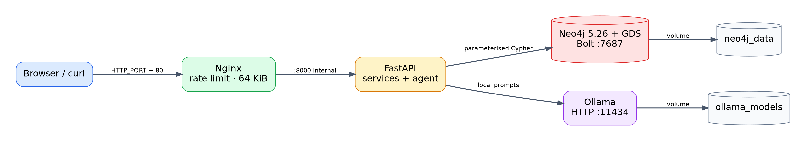

# ShockGraph PEA

[](https://github.com/Polluxgnr/shockgraph-pea/actions/workflows/lint.yml)
[](https://github.com/Polluxgnr/shockgraph-pea/actions/workflows/test.yml)
[](https://github.com/Polluxgnr/shockgraph-pea/actions/workflows/publish.yml)

**If oil goes up 20 % or the euro drops 5 %, what happens to my PEA, and through which links?**

More and more French students open a PEA and stack a "World" ETF, an S&P 500 ETF and a few stocks, thinking they
are diversified. Two "World" ETFs can hold the same 1,500 companies; a synthetic PEA ETF holds European stocks but
pays the performance of US ones. ShockGraph PEA maps PEA-eligible stocks, their sectors and countries, the
commodities, currencies and rates they depend on, and the ETFs that hold them, as a **Neo4j graph**. It shows what a
portfolio is really exposed to, how a shock spreads through the graph, and explains it with a **local LangGraph
agent** that never mixes facts, statistical estimates, model predictions and news hypotheses.

> Educational and analytical project. **Not investment advice**: it never recommends buying or selling, and the
> agent refuses to. Statistical sensitivities describe the past; correlation is not causation.

CentraleSupélec AIDAMS GraphDB project, October 2026, by Pollux, Eliott and Saty.

## Contents

[What it does](#what-it-does) · [Quick start](#quick-start) · [Two-minute tour](#two-minute-tour) · [Architecture](#architecture) ·
[Graph model](#graph-model) · [Data sources](#data-sources) · [API](#api) ·
[Design choices](#design-choices-and-why) · [Results](#results-in-numbers) · [Limits](#limits) ·
[Next steps](#what-we-would-do-next) · [Engineering](#how-we-worked) · [Repository map](#repository-map)

## What it does

| Question a student asks | Endpoint | What the graph does |
| --- | --- | --- |
| "What do my ETFs really hold?" | `POST /api/portfolio/xray` | Look-through `Fund -TRACKS-> Index -CONSTITUENT-> Company`, then aggregates by company, sector, country and factor |
| "Oil +20 %: what happens to my PEA?" | `POST /api/shocks/simulate` | Direct impact `beta × shock` on every company (truth `estimate`), declared producers / consumers (truth `fact`), then one hop further through news-based supplier links (truth `hypothesis`, no number) |
| "Why is Airbus linked to oil?" | `GET /api/paths` | Bounded `shortestPath` (≤ 6 hops) between any two nodes, each hop tagged with its truth level |
| "Which stocks move together?" | `GET /api/network/clusters`, `/systemic`, `/companies/{isin}/similar` | GDS on the residual correlation network: Louvain communities, PageRank, FastRP embeddings |
| "What moves TotalEnergies?" (free text) | `POST /api/ask` | LangGraph agent: rule-based advice refusal, typed tools, a guarded Cypher fallback, a verifier that removes unsupported claims |

Every number in an answer carries its `truth` (`fact`, `estimate`, `prediction`, `hypothesis`) and the evidence
references it comes from (`Company:FR0000120271`, `Factor:BRENT`, `Claim:c1`).

## Quick start

Requirements: Docker Desktop (8 GB RAM or more for the local LLM), Python 3.11+, `make`
(Windows: Git Bash, after `winget install ezwinports.make`).

```bash
git clone https://github.com/Polluxgnr/shockgraph-pea.git && cd shockgraph-pea
make env install        # .env from .env.example (edit the passwords) + .venv + git hooks
make docker-run         # nginx :80 -> api -> neo4j + gds, ollama (each starts once the one it needs is healthy)
make llm-pull           # once: qwen2.5 7b and 3b for the agent (~7 GB)
make seed               # real data: about 3 minutes with warm caches (first OpenFIGI pass ~55 min without a key)
make gds                # communities, PageRank and embeddings
```

`docker compose ps` shows the health of the 4 services. **Demo page: http://localhost** (portfolio x-ray, shock,
explained path, network, agent) · Swagger: http://localhost/docs · Neo4j browser: http://localhost:7474 ·
`make help` lists every command.

The API image is also published: `docker pull ghcr.io/polluxgnr/shockgraph-api:latest`.

## Two-minute tour

Everything below runs on the demo page, http://localhost: plain HTML and JavaScript served by the API, no build step
and no external script. Each tab calls the public API, so what you see is what `curl` would return.

1. **"Student portfolio"** fills the positions: Amundi PEA Monde (EWLD) 3,000 €, Amundi PEA S&P 500 (PSP5) 2,000 €,
   TotalEnergies 500 €, Airbus 500 €. The portfolio is sent with each request and never stored.
2. **Portfolio → Run the x-ray** (`POST /api/portfolio/xray`). Each ETF is followed to the companies of the index
   it tracks, and a company held through both ETFs is summed into one line: the US share, the weight of the 10
   largest lines, countries, sectors, and the portfolio's betas weighted by the euros invested.
3. **Shock → Brent +20 %, depth 2** (`POST /api/shocks/simulate`). The impact in % and in € on each position. Every
   line has a truth badge: blue `estimate` (beta × shock), green `fact` (declared link, direction only), orange
   `hypothesis` (news, never a number).
4. **"path" on a line** (`GET /api/paths`). The bounded shortest path from Brent to that company, each link coloured
   by its truth level: an explanation is only as strong as its weakest link.
5. **Network → Load the network** (`/api/network/systemic`, `/clusters`). PageRank and Louvain communities on the
   residual correlation network. Clicking any company opens its exposures, ML predictions and similar stocks.
6. **Ask the agent** (`POST /api/ask`, needs the `X-API-Key` from `.env`). The answer, its claims with badges, the
   claims the verifier removed and why, and the trace of every tool call. "Should I sell my S&P 500 ETF?" is
   refused before any model call. Below it, **Cypher guardrail** (`POST /api/agent/validate-cypher`) shows a write,
   an unbounded path, a `UNION` without `LIMIT` and a Unicode dash all refused, each with its reason.

The agent runs a 7B model locally: on a CPU an answer can take minutes (the page counts the seconds, and Nginx stops
waiting after 3 minutes); on a GPU it takes seconds.

## Architecture



One public entry point. Nginx enforces body size (64 KiB) and per-IP rate limits, then forwards `/api/*` to the
private FastAPI container, the only component that talks to Neo4j or Ollama. Submitted portfolios are processed in
memory and never stored. Details: [`docs/architecture.md`](docs/architecture.md).

## Graph model


9 labels, 15 relationship types, 11 uniqueness constraints (two on technical lock nodes), 6 range indexes (one on a relationship property),
3 full-text indexes. The full
contract is [`docs/schema.md`](docs/schema.md); why each node and relationship exists, and the alternatives we
rejected, are in [`docs/modeling.md`](docs/modeling.md).

**Four levels of truth, never mixed** (each relationship carries one, and the API and the agent report it):

| Truth | Example | Where it comes from |
| --- | --- | --- |
| `fact` | Norsk Hydro `PRODUCES` aluminium; Airlines `CONSUMES` jet fuel | Wikidata, issuer documents, our justified industry map |
| `estimate` | TotalEnergies `SENSITIVE_TO` Brent, beta 0.39, partial r² 0.44 | Regression on weekly prices (past behaviour, with its r² and window) |
| `prediction` | `PREDICTED_SENSITIVITY` where prices show no significant beta | ML model reading the company's position in the graph (probability ≥ 0.5) |
| `hypothesis` | `Claim` "A supplies B" extracted from two news headlines | Local LLM on headlines, confidence from distinct stories and publishers |

**Why a graph database?** The core questions are multi-hop: fund → index → company → industry → commodity, or
"through which chain does this shock reach my portfolio". In SQL each hop is a join whose depth must be known in
advance; in Cypher it is a pattern, and `shortestPath` explains a link we did not anticipate. GDS then runs
community detection and centrality directly on the same graph.

## Data sources

All free, no paid account; every key is optional. Raw answers are cached in `data/raw/` and `data/cache/`
(git-ignored) and every write is an idempotent `MERGE`. Terms and volumes: [`docs/data_sources.md`](docs/data_sources.md).

| Source | Used for |
| --- | --- |
| SSGA daily ETF holdings (ACWI, S&P 500, Europe, EM) | Index constituents, weights, GICS sector and industry, country |
| OpenFIGI | ISIN → every exchange listing and ticker |
| Nasdaq API, Wikipedia (MediaWiki API) | Nasdaq-100 and CAC 40 members; Nasdaq caps anchor the market-cap estimate |
| ECB Data Portal | EUR/USD reference rate, euro yields |
| Issuer pages (Amundi, iShares, BNP Paribas AM, Vanguard, Invesco) | 14 ETFs: TER, replication, PEA eligibility, one source URL each |
| Wikidata (SPARQL, by ISIN) | Products of each company (declared commodity exposure) |
| Yahoo Finance, FRED | Weekly prices of stocks, commodities, FX; interest rates |
| Google News RSS (GDELT optional) | Headlines only, never article text: supply-chain hypotheses |
| Ollama (local) | qwen2.5 for the agent and the claim extraction, offline and free |

## API

Interactive documentation with examples at `/docs`. Errors share one body (`{"detail", "errors"?}`): 404 unknown
entity, 409 refresh in progress, 422 validation (with field-level errors), 501 feature not merged, 503 database
unavailable.

| Method | Route | Notes |
| --- | --- | --- |
| GET | `/api/health` | Neo4j and GDS status (`ok` / `degraded`) |
| GET | `/api/companies?q=&sector=&pea_only=&limit=&cursor=` | Full-text search, cursor pagination (never `SKIP`) |
| GET | `/api/companies/{isin}`, `/exposures`, `/similar`, `/predicted-exposures` | Detail, every factor link with its truth, nearest embeddings, ML predictions |
| GET | `/api/factors`, `/api/factors/{code}/exposed` | Commodities, currencies, rates; most exposed companies |
| POST | `/api/portfolio/xray` | Look-through of a portfolio (stocks and ETFs) |
| POST | `/api/shocks/simulate` | One or several shocks, depth 1–3, optional positions |
| GET | `/api/paths?from=&to=&max_hops=` | Explained shortest path, at most 6 hops |
| GET | `/api/network/clusters`, `/api/network/systemic` | Louvain communities, PageRank ranking |
| POST | `/api/network/refresh` | Recompute GDS (API key) |
| GET | `/api/hypotheses?company_isin=&status=` | News-based supplier claims with their evidence |
| POST | `/api/ask` | Agent (API key, 6 requests / minute / IP) |
| POST | `/api/agent/validate-cypher` | Demo of the Cypher guardrail |

## Design choices and why

Each choice has a dated line in `docs/decisions/<role>.md`; the defence notes in `docs/defense/` list the
alternatives we rejected and the questions we expect.

**Data**
- **Universe from index holdings, not a screener.** SSGA publishes daily holdings of replicating ETFs for free:
  2,466 companies with weights, sector and country, and exactly the companies inside the ETFs students buy.
- **Market caps estimated from index weights**, calibrated on Nasdaq caps (one free call). They are **float** caps:
  LVMH shows about €100 bn instead of €190 bn because the Arnault family's half is not in the float, which is
  exactly the share an index investor can own.
- **PEA eligibility = EU/EEA ISIN and EU/EEA home listing.** An approximation of the legal rule (registered office
  and corporate tax), stated as such. UK and Swiss companies are correctly excluded.
- **Declared exposures only for commodities.** "Airlines consume jet fuel" is a defensible fact (one justification
  per line in `data/seed/industry_factors.csv`). "A bank is exposed to rates" is true but its sign differs by bank,
  so currencies and rates are only ever **estimated** from prices.
- **Wikidata matches are checked, not guessed**: Q-ids verified against their labels (four wrong ones caught),
  whole-word keywords, explicit exclusions; 1,386 unmatched products are counted in the report.
- **News: one vote per distinct story.** Ten outlets reprinting one wire count once; `confirmed` needs two stories
  from two publishers; confidence is capped at 0.95. A claim is a node (`Claim`), not a relationship, so it can
  point to its articles and carry its status.

**Statistics** (role C)
- **Market-controlled betas**: each stock is regressed on the factor **and** its market (STOXX 600 or MSCI World),
  so "oil beta" is not just "the market went up". The r² shown is the factor's **partial** r².
- **Weekly returns in the listing currency**: daily prices are noisy across time zones; converting to EUR would give
  every US stock a mechanical EUR/USD beta of about −1.
- **Correlations on residuals** (after removing the market): raw correlations would put every stock in one cluster.

**Queries and performance** (role B)
- **Cursor pagination** on `(market_cap_eur, isin)`: stable pages and no cost proportional to the page number.
- **Bounded paths everywhere** (`*..6`): on a dense correlation graph an unbounded path has no cost ceiling.
- **Every index justified by a PROFILE** before and after ([`docs/perf.md`](docs/perf.md)), including one that the
  planner did not use, kept in the report rather than hidden.

**LLM**
- **Local model (Ollama, qwen2.5).** Free, offline, and a student's portfolio never leaves the machine.
- **Typed tools first, Cypher last.** The model chooses tools and arguments; every number comes from a service with
  parameterised Cypher written by us. Tool arguments carry the same bounds as the HTTP routes.
- **Generated Cypher passes three layers**: an allow-list validator (read-only clauses, known labels, bounded
  paths, a `LIMIT` in every `UNION` branch: [`docs/guardrails.md`](docs/guardrails.md)), a READ transaction that
  the server refuses to write in, and a server-side timeout.
- **Advice is refused by a rule, before any model call**: a prompt can talk a model into a recommendation, not a
  regular expression.
- **A verifier checks every claim against the trace and the database**: each number tied to its row, evidence
  references that exist, a truth level never stated more strongly than its source, no causal wording on an
  estimate, and an advice judge (qwen2.5:7b against the MiFID II / AMF definition of investment advice).

## Results in numbers

| | |
| --- | --- |
| Universe (holdings of 22 Oct 2026) | 2,466 companies, **305 PEA-eligible**, 66 countries, 7 indexes, 14 ETFs, 5,658 `CONSTITUENT` |
| Ticker coverage | Yahoo symbol for 2,371 companies (96 %); CAC 40 resolved 40/40, Nasdaq-100 98/101 |
| Declared exposures | 12 factors, 28 industry links, 58 company `PRODUCES` from Wikidata, 45 hand-checked company links |
| News hypotheses | 2,727 headlines → 154 candidate pairs → 4 claims, all correct on reading, 1 confirmed |
| Betas and correlations (C1) | 2,109 stocks with prices, 3,579 significant `SENSITIVE_TO`, 3,818 `CORRELATED_WITH` (weekly, 3 years) |
| Network (C2) | 1,499 correlated stocks in 139 Louvain communities, PageRank and 64-d FastRP embeddings |
| ML (C3, temporal split) | AUC-PR 0.573 for gradient boosting vs 0.270 for the industry-share baseline; precision@100 1.00; 676 predictions written ([`docs/ml_report.md`](docs/ml_report.md)) |
| Index effect (20,000 companies) | ticker lookup 40,002 → 3 DB hits; `SKIP` page 200: 60,001 → 8,003 DB hits |
| Cypher guardrail | 50 refused queries (each with its expected reason), 18 accepted (each `EXPLAIN`-ed on Neo4j); 9 bypasses found in review, each now a test |
| Agent evaluation | 30 questions including 10 traps (advice, writes, invented company, causation, out of scope): [`docs/agent_eval.md`](docs/agent_eval.md) |
| Tests | 500+ tests (unit, API, Neo4j + GDS, containers, demo page), coverage ≥ 60 % enforced in CI (82 % at the last measure), pylint 10/10 |

## Limits

Said plainly, because a model of the economy that hides its limits is worse than none.

- **Betas describe the past.** A regression over three years says how a stock moved with oil, not how it will move;
  a low r² means "little evidence", and the API filters on it.
- **Declared links have no size.** "Airlines consume jet fuel" has a direction but no number, so the shock shows it
  without a euro amount.
- **Index weights approximate holdings.** Synthetic PEA ETFs hold a substitute basket that issuers publish only
  through JavaScript pages: the look-through uses the tracked index (the economic exposure), not the basket.
- **PEA eligibility is an approximation** of the legal rule; a broker's list is the reference.
- **News claims are rare and noisy by nature**: headlines only, 60 companies, 90 days. They are hypotheses, shown
  as such, never used to compute a number.
- **A regex validator is not a Cypher parser.** It refuses some exotic but valid queries (the safe direction), and
  the timeout, not the validator, bounds the work of a heavy legal query.
- **A 7B local model is slower and weaker than a hosted one.** The typed tools and the verifier are what keep its
  answers grounded, not the model.

## What we would do next

- Refresh holdings, prices and news on a schedule and keep the history (`as_of` already dates each company).
- Read the real substitute baskets of synthetic ETFs (`HOLDS` is modelled and tested, not loaded).
- Size the declared links (share of costs or revenues from annual reports) so they can carry a number.
- Regime-aware betas (rolling windows, a stress period) and confidence intervals in the API.
- Store the KNN of the embeddings as relationships when the universe grows beyond a few thousand stocks.
- Stream the agent's steps to the demo page, so a slow local model shows progress instead of one long wait.

## How we worked

- **Three roles, one owner per file.** `scripts/hooks/ownership.py` maps every file to a role and a pre-commit hook
  refuses a commit outside it; a change in someone else's file goes through an issue.
- **One task = one issue = one branch = one PR.** `main` is protected: CI green and one approval, merge commits only
  so each commit stays visible. Reviews rotate (A by C, B by A, C by B) with at least two specific comments; the
  guardrail PR went through six review rounds and each of the nine bypasses found became a test.
- **Hooks**: black, pylint ≥ 9.5, detect-secrets, no `.env` or data files, conventional commit messages.
- **CI**: lint, tests on a real Neo4j + GDS service with the mini graph (`tests/fixtures/`), and image publication
  to GHCR. Tests never call a real LLM (`LLM_PROVIDER=fake`).
- **Decisions are written down** (`docs/decisions/`), and each of us keeps defence notes (`docs/defense/`).

The full rules are in [`AGENTS.md`](AGENTS.md); the grading map is [`docs/demo_checklist.md`](docs/demo_checklist.md).

## Repository map

```text
app/            FastAPI: routers, services (one per domain), Pydantic models, agent, Neo4j client
scripts/        ingestion (scripts/ingest/), constraints, benchmarks, agent evaluation, git hooks
ml/             training of the exposure model
data/seed/      hand-checked CSVs: funds, factors, industry map, curated company links
tests/          unit, API, Neo4j and container tests; fixtures/mini_graph.cypher
docs/           schema, modeling, data sources, guardrails, performance, architecture, decisions, defence notes
nginx/          reverse proxy configuration
```

## Team

| Role | Member | Scope |
| --- | --- | --- |
| A (lead) | Pollux ([@Polluxgnr](https://github.com/Polluxgnr)) | Data ingestion, schema and modeling, Cypher guardrails, CI, README |
| B | Eliott ([@Tiltoe](https://github.com/Tiltoe)) | API services, Docker / Nginx / Ollama, performance, agent evaluation |
| C | Saty ([@exilonn](https://github.com/exilonn)) | Betas and correlations, GDS, ML, LangGraph agent, notebook |
