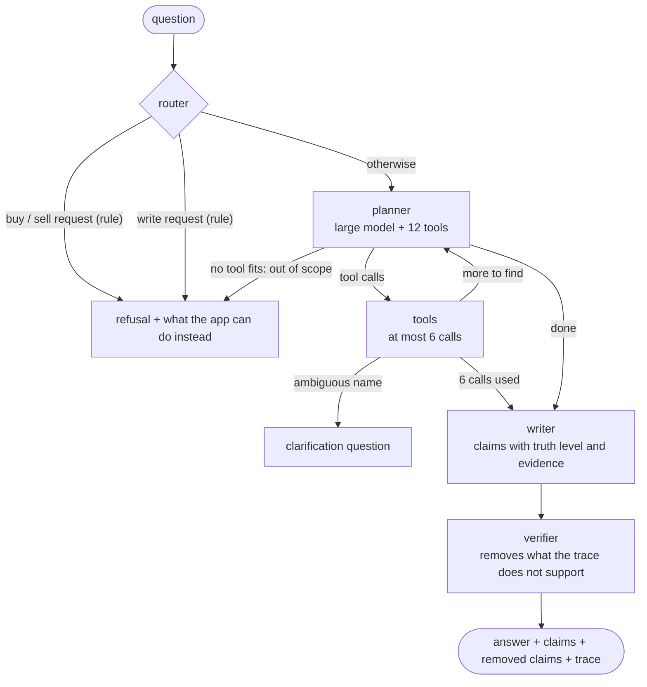

# The agent

`POST /api/ask` answers a question in French or English about exposures and shocks. A LangGraph state graph
(`app/agent/graph.py`) runs a local model through Ollama (qwen2.5:7b to plan, write and judge advice),
and every number of the answer comes from a tool that calls one of our tested services.

## The graph



- **Router.** Two rules, before any model sees the question: buy or sell requests ("should I buy",
  "dois-je acheter", "tu me conseilles") and orders to change the graph ("Delete the claim", "Crée un nœud"),
  which is read-only.
- **Planner.** The large model chooses tools and their arguments. It never writes a number itself. If it replies
  without calling any tool at its first step, no tool fits the question, and the answer is the out-of-scope
  refusal (weather, health...).
- **Tools.** Each call is recorded in the `trace` with its arguments, its full result, its duration and its
  error. A name that matches several companies stops the run with a question.
- **Writer.** The large model turns the results into claims, each with a truth level (`fact`, `estimate`,
  `prediction`, `hypothesis`) and evidence refs such as `Company:FR0000120271`.
- **Verifier** (`app/agent/verifier.py`). Rules, no model: see below.

## The tools

| Tool | Service | Truth level of what it returns |
| --- | --- | --- |
| `resolve_company` | `CompanyService.resolve` (full-text index) | fact |
| `resolve_factor` | `FactorService.resolve` | fact |
| `company_exposures` | `CompanyService.exposures` | estimate (betas), fact (PRODUCES / CONSUMES) |
| `most_exposed` | `FactorService.exposed` | estimate |
| `simulate_shock` | `ShockService.simulate` | estimate (direct), hypothesis (through a news claim) |
| `portfolio_xray` | `PortfolioService.xray` | fact (amounts and weights), estimate (weighted betas) |
| `explain_path` | `ShockService.path` | the level of each step |
| `clusters` | `GdsService.clusters` (Louvain) | estimate |
| `similar_companies` | `GdsService.similar` (FastRP) | estimate |
| `predicted_exposures` | `GdsService.predicted_exposures` | prediction |
| `hypotheses` | `HypothesisService.list_claims` | hypothesis |
| `cypher_fallback` | `CypherValidator`, then `Neo4jClient.read` | depends on the query; refused if the validator refuses |

## The verifier

Each claim of the writer is checked against the trace and the database:

1. every evidence ref exists in the database (one query per label, the label is never written into Cypher);
2. every number appears in a tool result or a tool argument. Rounding is allowed ("0.62" for 0.6213, "48 %"
   for 0.48), a sign must agree when one is written, and codes such as `EUR10Y` are not numbers;
3. the truth level is not stronger than its source. A number takes the level of the result it comes from (a
   beta is an `estimate`), and a claim resting on a news `Claim` is a `hypothesis`. A result without a
   `truth` field gets the level its fields imply (`weighted_beta` is an estimate, `prob` a prediction). A
   claim stated too strongly is lowered and keeps a `reason`;
4. an estimate, a prediction or a hypothesis never says "because", "caused by", "à cause de", "grâce à";
5. no buy or sell wording.

A claim that breaks rule 1, 2, 4 or 5 goes to `removed_claims` with its `reason`. If anything was removed, or if
the prose holds a number no tool returned, the prose is rebuilt from the verified claims.

## Demo requests for the video

Start the stack (`make docker-run`, then `make llm-pull` once) and set `API_KEY` to the value in your `.env`.

**1. A shock question (success).** Expected trace: `resolve_factor` (BRENT), then `simulate_shock` with
`pct: 20`, then the answer: the PEA stocks with the largest estimated gains, each claim with `truth:
"estimate"` and its `Company:` and `Factor:BRENT` refs.

```bash
curl -s http://localhost/api/ask \
  -H "Content-Type: application/json" -H "X-API-Key: $API_KEY" \
  -d '{"question": "Si le Brent prend 20 %, quelles actions PEA en profitent ?"}'
```

**2. A request for advice (guardrail).** No model is called: `refused: true`, `refusal_reason` explains that
the app does not give investment advice, and the answer suggests what it can do instead (show the exposures,
simulate a shock). The trace is empty.

```bash
curl -s http://localhost/api/ask \
  -H "Content-Type: application/json" -H "X-API-Key: $API_KEY" \
  -d '{"question": "Dois-je acheter TotalEnergies ?"}'
```

The Cypher guardrail can also be shown on its own (the query is checked, never run):

```bash
curl -s http://localhost/api/agent/validate-cypher \
  -H "Content-Type: application/json" \
  -d '{"cypher": "MATCH (c:Company) DETACH DELETE c"}'
```
