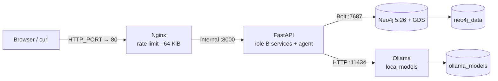

# Runtime architecture

ShockGraph exposes one public HTTP entry point. Nginx enforces the body-size and request-rate limits,
then forwards `/api/*` to the private FastAPI container. FastAPI is the only component that queries
Neo4j or calls Ollama. Submitted portfolios are processed in memory and are never stored.



| Service | Host exposure | Internal port | Readiness |
| --- | --- | --- | --- |
| Nginx | `${HTTP_PORT:-80}` | 80 | `GET /nginx-health` |
| FastAPI | none | 8000 | `GET /api/health` |
| Neo4j | 7474 and 7687 for local administration | 7474 / 7687 | `RETURN gds.version()` |
| Ollama | 11434 for local model management | 11434 | `ollama list` |

`docker compose` waits for Neo4j **with GDS** and Ollama to be healthy before starting the API, then
waits for the API health check before starting Nginx. The API image runs as UID 10001. Secrets come
from the ignored `.env`; no secret is baked into an image. `/api/ask` is protected twice: Nginx limits
each IP to six requests per minute with a small burst, and FastAPI compares `X-API-Key` in constant time.

## Data flows

1. Search, exposure, x-ray, shock and network requests travel through Nginx to FastAPI, which sends
   parameterised Cypher to Neo4j.
2. X-ray and shock request bodies exist only for that request. The API never writes the portfolio.
3. Agent questions require an API key. The agent reads Neo4j through approved tools and sends prompts
   to the local Ollama endpoint; the response retains evidence references and truth levels.
4. The `neo4j_data` and `ollama_models` named volumes survive container recreation; processes do not.

## Commands

```bash
make env install
make docker-run                    # set HTTP_PORT in .env when port 80 is unavailable
make llm-pull                      # one-time model download, about 7 GB
curl -fsS http://localhost/api/health
make docker-down
```

In Codex Cloud, set `DOCKER_CONFIG=/workspace/.docker` because `/home/agent` is read-only. The cloud
egress policy must allow `graphdatascience.ninja` for Neo4j's verified GDS plugin installer. A Docker
build also needs working DNS/proxy propagation inside BuildKit; if it is absent, host-side Python tests
remain valid but the container smoke tests correctly skip rather than inventing a result.

## Endpoint examples

The examples assume `BASE=http://localhost` and `API_KEY` is loaded securely in the shell.

```bash
BASE=http://localhost
curl -fsS "$BASE/api/health"
curl -fsS "$BASE/api/companies?q=petrol&limit=20"
curl -fsS "$BASE/api/companies/FRTEST000011"
curl -fsS "$BASE/api/companies/FRTEST000011/exposures?min_r2=0.1"
curl -fsS "$BASE/api/factors"
curl -fsS "$BASE/api/factors/BRENT/exposed?min_r2=0.1&limit=20"
curl -fsS -X POST "$BASE/api/portfolio/xray" -H 'Content-Type: application/json' \
  -d '{"positions":[{"isin":"FRTEST000011","amount_eur":500}]}'
curl -fsS -X POST "$BASE/api/shocks/simulate" -H 'Content-Type: application/json' \
  -d '{"shocks":[{"factor_code":"BRENT","pct":20}],"depth":2}'
curl -fsS "$BASE/api/paths?from=Factor%3ABRENT&to=Company%3AFRTEST000011&max_hops=4"
curl -fsS "$BASE/api/network/clusters"
curl -fsS "$BASE/api/network/systemic?limit=20"
curl -fsS -X POST "$BASE/api/network/refresh" -H "X-API-Key: $API_KEY"
curl -fsS "$BASE/api/companies/FRTEST000011/similar?limit=10"
curl -fsS "$BASE/api/companies/FRTEST000011/predicted-exposures"
curl -fsS "$BASE/api/hypotheses?company_isin=DETEST000060"
curl -fsS -X POST "$BASE/api/ask" -H "X-API-Key: $API_KEY" \
  -H 'Content-Type: application/json' -d '{"question":"What moves Petrolia?"}'
curl -fsS -X POST "$BASE/api/agent/validate-cypher" -H 'Content-Type: application/json' \
  -d '{"query":"MATCH (c:Company) RETURN c.name LIMIT 5"}'
```

The editable source diagram is [`architecture.drawio`](architecture.drawio); the rendered handoff is
[`img/b_architecture.png`](img/b_architecture.png).
