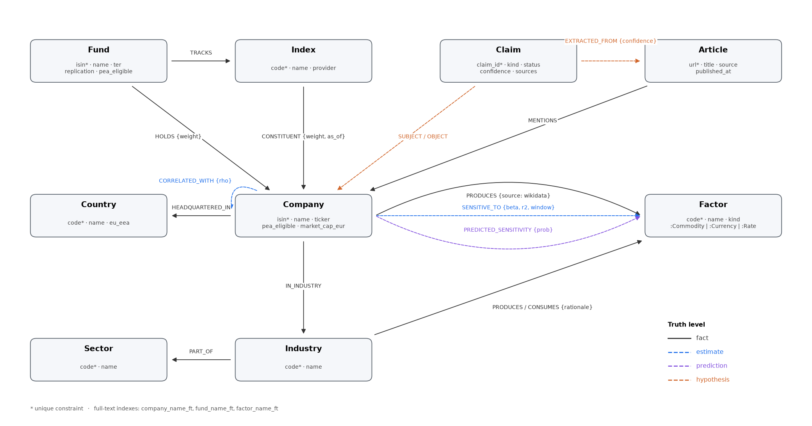
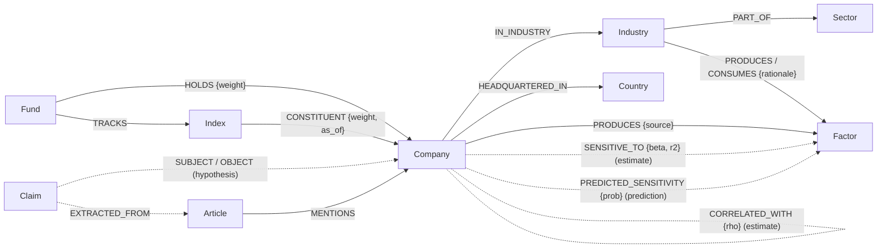

# Modeling rationale

The schema itself is in [`schema.md`](schema.md); this page explains **why** it looks like this and which
alternatives we rejected. Diagram: [`schema.drawio`](schema.drawio) (editable in diagrams.net), rendered below.





## The question drives the model

The app answers one question: *if a factor moves, which positions of a student's PEA move, by how much, and
through which links?* A shock therefore travels **Factor → Company → (Index → Fund) → position**, and every hop must
carry its level of truth. Each modeling choice below follows from that.

## Choices and rejected alternatives

### 1. One `Factor` label with a sub-label, not three labels

`(:Factor:Commodity {code: 'BRENT'})`, `(:Factor:Currency {code: 'EURUSD'})`, `(:Factor:Rate {code: 'EUR10Y'})`.

- **Rejected: `Commodity`, `Currency`, `Rate` as separate labels.** Every shock, exposure and beta query would have
  to `UNION` three patterns or use `(c)-[:SENSITIVE_TO]->(x:Commodity|Currency|Rate)`, and one uniqueness
  constraint per label could not stop `BRENT` existing twice. With one label: one constraint (`factor_code`), one
  full-text index, one pattern. The sub-label still lets a query restrict to commodities with an index-backed label
  scan.

### 2. A fund needs both `TRACKS` and `HOLDS`

Most PEA "World" or "S&P 500" ETFs are **synthetic**: to be PEA-eligible they physically hold a basket of European
stocks (`HOLDS`) and receive the index performance through a swap. The money is exposed to the index, not to the
basket.

- **Rejected: only `HOLDS`.** A look-through would conclude that a CW8 holder owns European banks and chemicals
  instead of Apple, NVIDIA and Microsoft: exactly the misunderstanding we want to correct.
- **Rejected: copying index constituents onto each fund.** 14 funds × up to 2,228 constituents duplicated, and
  every index rebalance would have to be applied 14 times. `Fund -TRACKS-> Index -CONSTITUENT-> Company` stores the
  composition once. The look-through is a fixed 2-hop pattern, so its cost grows with the number of constituents
  of the tracked index (≤ 2,228), not with the size of the graph.

### 3. Prices stay out of the graph

Weekly prices live in `data/cache/*.parquet`; the graph stores what is **derived** from them (`SENSITIVE_TO`,
`CORRELATED_WITH`).

- **Rejected: `(:PricePoint {date, close})-[:OF]->(:Company)`.** 2,466 companies × 156 weeks = 385,000 nodes that
  no graph query traverses: time series are column scans, which Parquet and pandas do better. Neo4j would pay
  storage and memory for nothing.

### 4. Declared facts and statistical estimates are different relationships

`PRODUCES` / `CONSUMES` say *that* a company depends on a factor (a fact, with `source` and `rationale`).
`SENSITIVE_TO` says *how much* its stock moved with it (an estimate, with `beta`, `r2`, `t_stat`, window).

- **Rejected: one `EXPOSED_TO {beta, channel}` relationship.** It would put a sourced fact and a regression output
  on the same edge, so the API could not tell the user which part is evidence and which is a statistic. Separate
  types also let them disagree visibly (an airline whose beta to oil is weak this window still `CONSUMES` it).

### 5. Declared dependencies at **industry** level, not sector level and not per company

`(:Industry)-[:CONSUMES {rationale}]->(:Factor)`, inherited by every company of the industry; Wikidata adds
company-level `PRODUCES` where it has data.

- **Rejected: sector level (11 GICS sectors).** "Industrials" mixes airlines (big oil consumers) and software-like
  professional services; the dependency is only true at industry level (75 industries).
- **Rejected: hand-written company level.** 2,466 companies cannot be documented by hand, and free company-level
  input data does not exist. An industry line can be defended in one sentence ("jet fuel is 20–30 % of airline
  costs").

### 6. `CORRELATED_WITH` is stored once, and only for the strongest pairs

Top 5 neighbours per stock with ρ ≥ 0.5 on residual returns, stored with `a.isin < b.isin`, queried undirected.

- **Rejected: the full correlation matrix.** 2,466² / 2 ≈ 3 million edges, almost all noise, and Louvain on a dense
  graph finds one blob. A sparse k-nearest-neighbour graph is the standard input for community detection.
- **Rejected: storing both directions.** Correlation is symmetric; two edges would double the storage and make
  PageRank count each link twice.

### 7. A news claim is a **node**, not a relationship

`(:Claim {status, confidence})-[:SUBJECT]->(supplier)`, `-[:OBJECT]->(customer)`, `-[:EXTRACTED_FROM]->(:Article)`.

- **Rejected: `(supplier)-[:SUPPLIES {source}]->(customer)`.** One relation is supported by several articles, each
  with its own confidence and extractor; a relationship cannot point to other nodes, so the provenance would be
  flattened into a list property. Reifying the claim keeps every source traversable, lets the claim change status
  (`hypothesis` → `confirmed`, or `rejected` by a human), and keeps hypotheses physically separate from facts: a
  traversal over `PRODUCES`/`CONSUMES` can never pick up a news rumour by accident.

### 8. The portfolio is never stored

`POST /api/portfolio/xray` and `POST /api/shocks/simulate` receive the positions in the request body and forget them.

- **Rejected: `(:Student)-[:OWNS]->(:Portfolio)-[:HOLDS]->(:Company)`.** A portfolio is personal financial data:
  storing it would need accounts, authentication per user and a GDPR basis, for no analytical gain, since every
  question is about one portfolio at a time. `UNWIND $positions` joins it to the graph inside the query.

### 9. `HEADQUARTERED_IN` is the country of incorporation

The ISIN prefix is the country of incorporation, which is what PEA eligibility legally depends on (registered
office in the EU/EEA). The listing country is kept as `Company.listing_country`. Limits are listed in
[`decisions/a.md`](decisions/a.md).

### 10. Market cap is a float estimate, labelled as such

`market_cap_eur` is computed from index weights calibrated on real Nasdaq market caps, with
`market_cap_method = 'float_estimate_from_index_weights'`. It ranks and weights companies correctly; it is not a
valuation (LVMH shows ≈ €100 bn because about half its shares are family-held and do not float).

## Constraints and indexes, and the query each one serves

| Index | Serves |
| --- | --- |
| `company_isin`, `fund_isin`, `factor_code`, `index_code`, ... (uniqueness) | Every `MERGE` of the ingestion (index seek instead of a label scan) and every lookup by key in the API |
| `company_name_ft`, `fund_name_ft`, `factor_name_ft` (full-text) | Search endpoint and the agent's entity resolution ("pétrole" → `BRENT`, "Total" → TotalEnergies) |
| `company_ticker`, `fund_ticker` | Joining price data and Yahoo symbols back to nodes |
| `company_pea` | `pea_only=true` filters |
| `sensitive_r2` (relationship index) | "Most exposed companies" with `r2 >= $min_r2` |
| `claim_status` | `GET /api/hypotheses?status=...` |

The before/after `PROFILE` measurements are in [`perf.md`](perf.md) (role B).

---

## Appendix: anti-genericity

**Method.** A separate assistant with **no access to this repository or this conversation** received only this
sentence: *"Neo4j graph of PEA stocks, sectors, commodities and macro factors to simulate the impact of a
commodity shock on a student's portfolio"*, and was asked for a schema (labels, relationships, constraints, one
shock query). Its answer is pasted unchanged, then compared with ours.

<details>
<summary><b>The generic schema, as returned (25 Oct 2026)</b></summary>

> ### Node labels
>
> | Label | Properties |
> |---|---|
> | `Student` | `id`, `name`, `riskProfile` (low/medium/high) |
> | `Portfolio` | `id`, `name`, `cashEUR`, `openedAt` |
> | `Stock` | `isin`, `ticker`, `name`, `country`, `currency`, `price`, `marketCap`, `peaEligible` (bool) |
> | `Sector` | `code` (GICS), `name` |
> | `Commodity` | `code` (BRENT, TTF_GAS, COPPER, WHEAT...), `name`, `unit`, `spotPrice` |
> | `MacroFactor` | `code` (EURUSD, ECB_RATE, HICP...), `name`, `value`, `unit` |
> | `Scenario` | `id`, `name`, `createdAt`, `description` |
>
> ### Relationships
>
> | Pattern | Properties |
> |---|---|
> | `(Student)-[:OWNS]->(Portfolio)` | `since` |
> | `(Portfolio)-[:HOLDS]->(Stock)` | `quantity`, `avgCost`, `since` |
> | `(Stock)-[:IN_SECTOR]->(Sector)` | none |
> | `(Stock)-[:EXPOSED_TO]->(Commodity)` | `beta` (stock % move per 1% commodity move), `channel` (input/output), `revenueShare` |
> | `(Sector)-[:SENSITIVE_TO]->(Commodity)` | `beta` (fallback when a stock has no direct beta) |
> | `(Commodity)-[:DRIVES]->(MacroFactor)` | `elasticity`, `lagDays` |
> | `(Stock)-[:SENSITIVE_TO]->(MacroFactor)` | `beta` |
> | `(Scenario)-[:SHOCKS]->(Commodity)` | `pctChange` |
> | `(Scenario)-[:IMPACTED]->(Portfolio)` | `pnlEUR`, `pctReturn`, `runAt` (stored result) |
>
> Direction always runs from cause to effect (commodity, then macro, then stock) or from owner to asset, so you
> read the shock paths left to right.
>
> ### Constraints and indexes
>
> ```cypher
> CREATE CONSTRAINT stock_isin   FOR (s:Stock)       REQUIRE s.isin IS UNIQUE;
> CREATE CONSTRAINT commo_code   FOR (c:Commodity)   REQUIRE c.code IS UNIQUE;
> CREATE CONSTRAINT sector_code  FOR (s:Sector)      REQUIRE s.code IS UNIQUE;
> CREATE CONSTRAINT macro_code   FOR (m:MacroFactor) REQUIRE m.code IS UNIQUE;
> CREATE CONSTRAINT pf_id        FOR (p:Portfolio)   REQUIRE p.id IS UNIQUE;
> CREATE CONSTRAINT student_id   FOR (s:Student)     REQUIRE s.id IS UNIQUE;
> CREATE CONSTRAINT scenario_id  FOR (s:Scenario)    REQUIRE s.id IS UNIQUE;
>
> CREATE INDEX stock_ticker FOR (s:Stock) ON (s.ticker);
> CREATE INDEX stock_pea    FOR (s:Stock) ON (s.peaEligible);
> CREATE TEXT INDEX stock_name FOR (s:Stock) ON (s.name);
> ```
>
> ### Example: simulate a -30% Brent shock
>
> The query uses the direct stock beta, falls back to the sector beta when there is none, and adds the
> second-order effect through macro factors.
>
> ```cypher
> :param commodity => 'BRENT';
> :param pct => -0.30;
> :param portfolio => 'PF-001';
>
> MATCH (p:Portfolio {id: $portfolio})-[h:HOLDS]->(s:Stock)
> MATCH (c:Commodity {code: $commodity})
> OPTIONAL MATCH (s)-[d:EXPOSED_TO]->(c)
> OPTIONAL MATCH (s)-[:IN_SECTOR]->(:Sector)-[sb:SENSITIVE_TO]->(c)
> OPTIONAL MATCH (c)-[m:DRIVES]->(:MacroFactor)<-[sf:SENSITIVE_TO]-(s)
> WITH s, h,
>      coalesce(d.beta, sb.beta, 0.0)            AS directBeta,
>      sum(coalesce(m.elasticity * sf.beta, 0.0)) AS macroBeta
> WITH s, h.quantity * s.price AS value,
>      $pct * (directBeta + macroBeta) AS ret
> WITH collect({ticker: s.ticker, value: value,
>               pctImpact: round(ret * 100, 2),
>               pnlEUR: round(value * ret, 2)}) AS lines
> WITH lines,
>      reduce(t = 0.0, l IN lines | t + l.pnlEUR) AS totalPnl,
>      reduce(v = 0.0, l IN lines | v + l.value)  AS totalValue
> RETURN lines, totalPnl,
>        round(100 * totalPnl / totalValue, 2) AS portfolioPctReturn;
> ```
>
> To keep a result, add a `MERGE (sc:Scenario {id: ...})`, then `MERGE (sc)-[:SHOCKS {pctChange: $pct}]->(c)` and
> `MERGE (sc)-[:IMPACTED {pnlEUR: totalPnl, runAt: datetime()}]->(p)`. This lets you compare scenarios over time.
>
> ### Design notes
> - **Betas on the edges:** they are kept as relationship properties, so you can recalibrate them from regressions
>   on price history without changing the graph structure.
> - **Sector fallback:** sector betas give coverage for small caps that have no stock-level estimate.
> - **Macro layer:** this captures indirect effects, for example oil, then HICP, then the ECB rate, then banks. It is
>   limited to one hop to avoid counting the same effect twice.
> - **PEA eligibility:** `peaEligible` lets you filter the investable universe, which is EU/EEA equities.

</details>

### Point-by-point comparison

| # | Generic schema | Ours | Why we differ |
| --- | --- | --- | --- |
| 1 | **No funds, no indexes.** A portfolio holds `Stock`s only. | `Fund -TRACKS-> Index -CONSTITUENT-> Company`, plus `HOLDS` for the physical basket. | Students mostly hold ETFs. Without the index layer the app cannot see that CW8 + an S&P 500 ETF is 60 % the same companies, the central insight. And a synthetic PEA ETF's `HOLDS` would give the wrong exposure (choice 2). |
| 2 | `Student`, `Portfolio`, stored `HOLDS {quantity, avgCost}`. | No user data; positions live only in the request. | Personal financial data, accounts and GDPR for no analytical gain (choice 8). |
| 3 | One `EXPOSED_TO {beta, channel, revenueShare}`. | `PRODUCES`/`CONSUMES` (fact, sourced) separate from `SENSITIVE_TO` (estimate, with r² and window). | One edge would mix evidence and statistics; the API could not label the truth level of a number (choice 4). `revenueShare` has no free source at this scale. |
| 4 | `Sector -SENSITIVE_TO {beta}-> Commodity` as a **fallback beta**. | Industry-level dependency **without a number**; numbers only from a company's own regression. | A sector-average beta given to a company that has none is a guess shown as a measurement. We show "its industry consumes oil" (fact) and leave the impact unknown when there is no estimate. Also: 11 sectors are too coarse (choice 5). |
| 5 | `Commodity` and `MacroFactor` as two labels. | One `Factor` label with `:Commodity`, `:Currency`, `:Rate` sub-labels. | One constraint, one full-text index, one pattern for every shock query (choice 1). |
| 6 | `(Commodity)-[:DRIVES {elasticity, lagDays}]->(MacroFactor)`, a causal chain oil → inflation → ECB rate → banks. | Not modelled. | Asserting a causal macro chain with fixed elasticities is exactly the "correlation presented as causation" the subject forbids. Our betas are estimated with a market control, and second-order effects only travel through sourced claims, labelled `hypothesis`. |
| 7 | `price`, `spotPrice`, `value` stored as node properties. | Prices outside the graph; only derived estimates stored, with their window. | A stored price is stale the next day, and time series are not traversals (choice 3). |
| 8 | `Scenario` and `IMPACTED {pnlEUR}` stored. | Shocks computed on request, never stored. | A stored result silently goes stale when betas are recomputed; computing takes milliseconds on a bounded pattern. |
| 9 | Missing: provenance, news, uncertainty. | `Claim` nodes with sources, confidence and status; four truth levels on every number. | The subject requires distinguishing verified facts from AI-generated suggestions; the generic model has no place for either. |
| 10 | Missing: any stock-to-stock structure. | `CORRELATED_WITH` (sparse top-k) for Louvain and PageRank. | Needed for the GDS part ("these five stocks are really one bet") and the ML features. |
| 11 | `coalesce(d.beta, sb.beta, 0.0)` in the shock query. | Unknown impact stays `null` and is labelled; `r2 >= $min_r2` filter. | `0.0` claims "no impact" when the truth is "we don't know": the opposite of what a careful tool should say. |
| 12 | `TEXT INDEX` on the name. | Full-text (Lucene) indexes on names and tickers. | A text index supports `CONTAINS`; the agent needs fuzzy, scored matching ("Total" → TotalEnergies, "pétrole" → Brent). |

**Where the generic schema is right, and we agree:** ISIN as the stock key with a uniqueness constraint; betas as
relationship properties, so they can be recomputed without touching the structure; a `peaEligible` flag with an
index; GICS codes as sector keys.

**What the comparison shows.** The generic answer is a reasonable portfolio database with a shock formula. Ours is
shaped by three things the one-sentence brief does not say: students hold **synthetic ETFs** whose holdings differ
from their exposure; the subject requires **separating facts, estimates, predictions and hypotheses**; and personal
portfolios should **not be stored**. Every difference in the table follows from one of these three.
