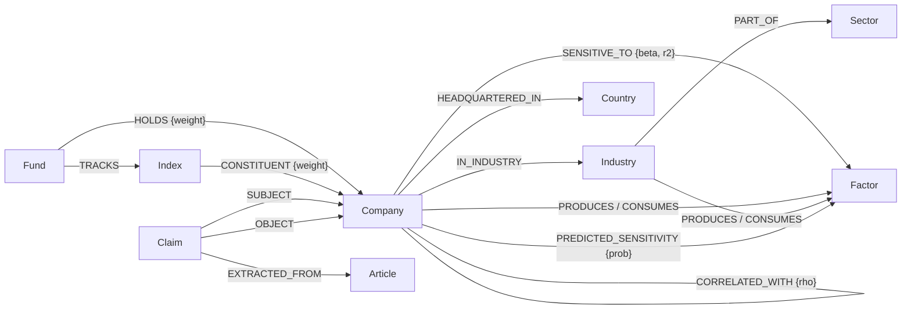

# Graph schema (contract)

This file and `scripts/constraints.cypher` are the contract shared by the three roles.
You may **add** a property, a label or a relationship. You never rename or delete an existing one.
Owner: role A. Any addition goes through a PR reviewed by another role.

## The idea in one picture

## Four levels of truth (never mixed)

| Truth level | Where it lives | Produced by | Shown as |
| --- | --- | --- | --- |
| `fact` | `CONSTITUENT`, `HOLDS`, `TRACKS`, `IN_INDUSTRY`, `HEADQUARTERED_IN`, `PRODUCES`, `CONSUMES` | Issuer files, Wikidata, curated sector map | stated plainly |
| `estimate` | `SENSITIVE_TO`, `CORRELATED_WITH` | Regression on weekly returns (role C) | "historically moved with…", always with `r2` and window |
| `prediction` | `PREDICTED_SENSITIVITY` | ML model (role C) | "the model predicts…", with `prob` and `model_version` |
| `hypothesis` | `Claim` nodes | LLM extraction from news (role A) | "a news source suggests…", with `confidence` and URL |

An API response or an agent answer carries the truth level of every number it shows (`truth` field).

## Nodes

| Label | Key (unique) | Properties |
| --- | --- | --- |
| `Company` | `isin` | `name`, `ticker` (Yahoo symbol, e.g. `TTE.PA`), `lei`, `currency`, `market_cap_eur`, `pea_eligible` (bool), `wikidata_id`, `figi`, `listing_country`, `market_cap_method`, `as_of` (date of the last holdings file the company was in: filter `c.as_of = max(as_of)` for the current universe) |
| `Fund` | `isin` | `name`, `ticker`, `issuer`, `ter` (annual fee, %), `replication` (`physical` / `synthetic`), `pea_eligible` (bool), `source_url` |
| `Index` | `code` | `name`, `provider` |
| `Sector` | `code` | `name` (GICS-like, 11 sectors) |
| `Industry` | `code` | `name` |
| `Country` | `code` (ISO 3166-1 alpha-2) | `name`, `eu_eea` (bool) |
| `Factor` | `code` | `name`, `kind` (`commodity` / `currency` / `rate`), `unit`, `source`, `source_id` (Yahoo symbol or FRED/ECB series). Also carries **one** sub-label: `:Commodity`, `:Currency` or `:Rate` |
| `Article` | `url` | `title`, `source` (domain), `published_at` (date) |
| `Claim` | `claim_id` | `kind` (`SUPPLIES`, `COMPETES_WITH`), `confidence` (0–1), `status` (`hypothesis` / `confirmed` / `rejected`), `sentence`, `model` |

Daily price series are **not** stored in the graph: they stay in `data/cache/*.parquet`.
The graph only stores what is derived from them (`SENSITIVE_TO`, `CORRELATED_WITH`).

## Relationships

| Type | From → To | Properties | Truth |
| --- | --- | --- | --- |
| `TRACKS` | Fund → Index | | fact |
| `HOLDS` | Fund → Company | `weight` (0–1), `as_of` (date) | fact (what the fund physically owns) |
| `CONSTITUENT` | Index → Company | `weight` (0–1), `as_of` (date) | fact |
| `IN_INDUSTRY` | Company → Industry | | fact |
| `PART_OF` | Industry → Sector | | fact |
| `HEADQUARTERED_IN` | Company → Country | | fact |
| `PRODUCES` | Company or Industry → Factor | `source` | fact |
| `CONSUMES` | Company or Industry → Factor | `source` | fact |
| `SENSITIVE_TO` | Company or Fund → Factor | `beta`, `r2` (**partial** r² of the factor, t² / (t² + dof)), `t_stat`, `n_obs`, `window_start`, `window_end`, `method`, `move_unit` (`pct` for prices, `pp` for rates: `impact_pct = beta × move` with a rate move in percentage points) | estimate |
| `CORRELATED_WITH` | Company → Company (stored once, `a.isin < b.isin`, queried undirected) | `rho`, `window_end` | estimate |
| `PREDICTED_SENSITIVITY` | Company → Factor | `prob`, `direction` (`up` / `down`), `model_version` | prediction |
| `SUBJECT` / `OBJECT` | Claim → Company | | hypothesis |
| `EXTRACTED_FROM` | Claim → Article | | hypothesis |
| `MENTIONS` | Article → Company or Factor | | fact (the article exists and names them) |

## Why a synthetic ETF needs both `HOLDS` and `TRACKS`

Most PEA "World" ETFs are synthetic: to stay PEA-eligible they physically hold a basket of European
stocks (`HOLDS`) and receive the index performance through a swap. The student's **economic exposure**
is the index (`TRACKS` → `CONSTITUENT`), not the basket. Look-through always follows `TRACKS`;
`HOLDS` is only shown to explain the difference.

## Evidence identifiers

Everywhere (API, agent, tests), a node is referenced as `Label:key`:
`Company:FR0000120271`, `Fund:FR0011869353`, `Factor:BRENT`, `Index:IDX_WORLD`, `Claim:c1`, `Article:<url>`.

## Constraints and indexes

See `scripts/constraints.cypher`. Range index `company_market_cap` on `Company.market_cap_eur` serves the paginated search (ordering and cursor).
Full-text indexes: `company_name_ft` (name, ticker), `fund_name_ft`
(name, ticker), `factor_name_ft` (name, code). Do not rename them: services and the agent depend on them.
